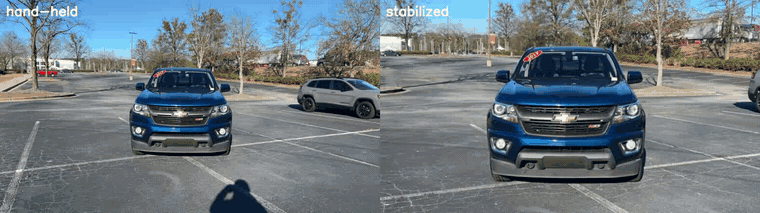
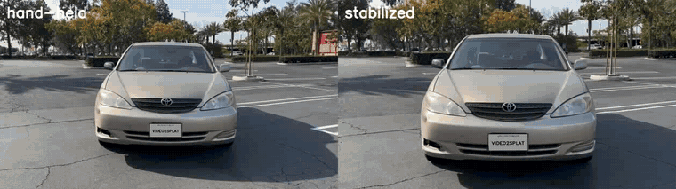
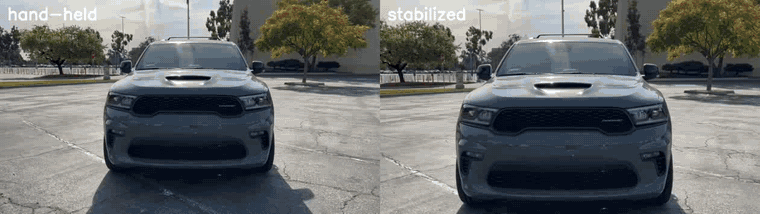

# spin-stabilizer

Turn a hand-held 360° walk-around into a **level, centred, evenly spaced turntable spin**, using nothing but
the camera poses and sparse points from Structure-from-Motion.



*A 70 s phone walk-around of a Chevy Colorado (left: nearest hand-held frame; right: stabilized). The licence
plate was replaced with [video-to-splat's multi-view plate replacement](https://github.com/neelgajera/video-to-splat#plate-replacement-replace_platespy-v2splatespy).*

## Results

Jitter = RMS second difference (acceleration) of the subject's sparse SfM points along the spin, in source
pixels. "Floor" is the same measure for a mathematically perfect turntable through the same views. Points
still move on curves there, so it isn't zero.

| Capture | Poses | Output frames | Jitter before → after | Floor | Roll std before → after |
|---|---|---|---|---|---|
| Chevy Colorado (real, 1920×1080) | COLMAP, 180 frames | 72 | 40.3 → **10.4 px** | 4.4 px | 1.67° → **0°** |
| Toyota Camry (real, 1280×720) | COLMAP, 180 frames | 72 | 22.5 → **12.1 px** | 4.1 px | 0.88° → **0°** |
| Dodge Durango (real, 1280×720) | COLMAP, 180 frames | 72 | 17.0 → **11.9 px** | 4.0 px | 0.94° → **0°** |
| Chevy Colorado | COLMAP, 180 frames | 28 | 70.2 → **33.8 px** | 29.0 px | 1.73° → **0°** |
| Chevy Colorado | **VGGT**, 28 frames | 28 | 77.8 → **52.8 px** | 26.3 px | 1.55° → **0°** |
| Synthetic (±3° roll, aim jitter) | exact | 72 | 81.4 → **10.6 px** | 1.7 px | 3.2° → **0°** |

**COLMAP vs VGGT poses.** VGGT's cameras agree with COLMAP to a median of **0.48°** in rotation and **0.67%
of the orbit radius** in position. On a 6 GB laptop GPU it handles 28 frames per pass in **34 s** (5.4 GB
peak), against 11.8 min for COLMAP on 180 frames. VGGT removes roll completely and cuts jitter by a third,
which makes it a good instant preview. At the same 28 output frames, COLMAP's tighter poses land within
17% of the perfect-turntable floor, so it's the final-quality option. Bundle-adjusting VGGT's output would close most of the gap (see *next steps*).

The gain is largest on shaky captures. The Camry and Durango walk-arounds were already steady, so
stabilizing mostly removes roll and evens out the spacing.

| Toyota Camry | Dodge Durango |
|---|---|
|  |  |

Stabilizing itself takes ~3 s on a CPU. Reproduce the synthetic row with
`python tests/make_synthetic.py data/synthetic && python stabilize.py data/synthetic`
([synthetic GIF](docs/before_after.gif)).

## Why

Dealers, marketplaces and e-commerce sites show products as interactive 360° spins. A turntable produces
perfect ones, but most items (cars, furniture) are filmed by someone walking around them with a phone. Those
frames tilt, drift off-centre, change scale and are unevenly spaced, so the spin wobbles. Classic 2D video
stabilizers smooth the shake but don't know the camera is orbiting a subject, so they can't produce evenly
spaced, level views.

## How it works

1. **Poses.** Any undistorted COLMAP model works: run COLMAP, or use
   [video-to-splat](https://github.com/neelgajera/video-to-splat) with `--poses vggt` to get poses from a single
   [VGGT](https://github.com/facebookresearch/vggt) forward pass in seconds.
2. **Orbit fit** ([`spinstab/orbit.py`](spinstab/orbit.py)).
   - *Subject centre*: the least-squares point closest to all optical axes, i.e. what the operator aimed at.
   - *Up axis*: normal of the PCA plane through the camera centres, oriented with the cameras' up vectors.
   - *Orbit*: algebraic (Kasa) circle fit in that plane. With `--path smooth` (default), radius and height
     follow the capture's slow changes (circular Gaussian, σ = 30°), which keeps virtual cameras close to real ones.
3. **Virtual cameras.** N cameras at uniform angles on the orbit, aimed at the subject centre with zero roll.
4. **Warp** ([`spinstab/warp.py`](spinstab/warp.py)). Each output frame comes from the nearest real frame
   through the homography induced by the plane through the subject centre facing the virtual camera:

   $$H = K_v\left(R_{rel} + \frac{t_{rel}\, n_s^\top}{d_s}\right)K_s^{-1}$$

   This corrects rotation, roll, height and distance in one warp, and the subject plane is registered exactly.
5. **Auto-zoom.** A binary search picks the smallest zoom with no black borders on 95% of frames.
6. **Metrics.** Sparse SfM points near the subject are tracked through the raw and warped frames, and the RMS
   of their second difference (acceleration) measures jitter. The same points through ideal turntable cameras
   give the floor.

## Usage

```bash
pip install -r requirements.txt
python stabilize.py path/to/dataset                 # dataset = images/ + sparse/0/ (undistorted PINHOLE)
python stabilize.py path/to/dataset --frames 36 --path circle --out out/
```

Outputs: `spin.mp4`, `before_after.mp4`, `frames/NNN.jpg` (for a web 360 viewer) and `metrics.json`.

From a phone video:

```bash
python ../video-to-splat/run.py walkaround.mp4 --until poses              # COLMAP, minutes
python ../video-to-splat/run.py walkaround.mp4 --until poses --poses vggt # VGGT, seconds
python stabilize.py ../video-to-splat/runs/walkaround/dataset
```

## Limitations and next steps

- VGGT poses are ~0.5° off COLMAP's. Refining them with bundle adjustment on tracked points (as
  in VGGT's `demo_colmap.py --use_ba`) should bring the VGGT row close to the COLMAP row.
- A single homography is exact only on the subject plane. Points far in front of or behind it keep some
  parallax, which is the gap between the stabilized and floor numbers above. Next step: a content-preserving
  mesh warp (Liu et al., *Content-Preserving Warps for 3D Video Stabilization*, SIGGRAPH 2009) driven by
  the same sparse points.
- Assumes one roughly closed orbit around one subject.
- Output frames come from real frames, so angles the capture skipped can't be filled.
  [video-to-splat](https://github.com/neelgajera/video-to-splat) solves that by rendering any angle from a 3D model.

## Background

I led the production version of this idea, a 360° car cataloging product for dealerships, at Spyne
([spyne.ai/360-car-photography](https://www.spyne.ai/360-car-photography)). This repository is an
independent re-implementation written from scratch on synthetic and self-captured data. It contains no
Spyne code, models or data.

## License

MIT, see [LICENSE](LICENSE).
